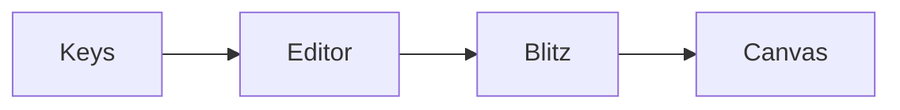

# Leaf, in a browser

This is **leaf**, a Markdown editor that draws what you write as it will
read: the same editor as the Mac app, compiled to WebAssembly and drawn
into a canvas by [Blitz](https://github.com/DioxusLabs/blitz).

Click anywhere and type. Select a word and press **⌘B** (Ctrl+B elsewhere)
to make it _bold_; **⌘I** for italics; **⌘Z** to undo.

## What it can show

- Lists, as you see, with `inline code` and [links](https://diaryx.org).
- Quotes, tables, code blocks and footnotes.[^1]
- Formulas and diagrams, typeset in the page.
- Pictures: a file served beside the page, a `data:` URI, or one dropped
  on the page.


> A quote, set off by a bar in the margin.

| Format   | Opened by   |
| -------- | ----------- |
| Markdown | twig        |
| Djot     | twig        |

```rust
fn main() {
    println!("hello from leaf");
}
```

$$
e^{i\pi} + 1 = 0
$$



[^1]: Footnotes are kept where they are written.
