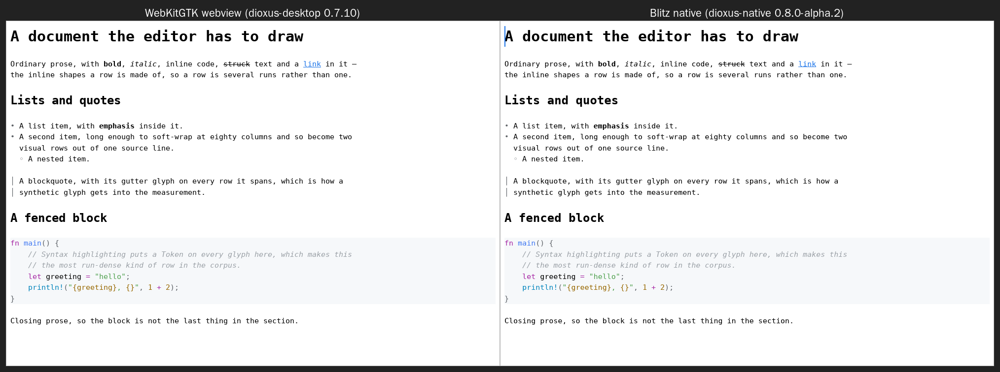

# Spike: leaf's editing surface through a virtual DOM

Could one [Dioxus](https://dioxuslabs.com) widget (0.7.10, MIT/Apache-2.0) be
leaf's web, desktop and mobile frontend at once — the place `leaf-web` (a
framework-agnostic JS editor over `leaf-wasm`), `leaf-gpui`, `leaf-swift` and
`leaf-android` each stand today? Dioxus renders a virtual DOM from Rust to a
browser, to a webview on desktop and mobile, and (`dioxus-native`, 0.8-alpha)
to a GPU surface.

The question that decides it is narrow enough to measure: **what does a
keystroke cost through a virtual DOM**, when leaf already knows exactly which
row changed. A frontend that re-derives the frame per keystroke pays for the
document; leaf's whole frame model (`leaf-core`'s `frame.rs`, and `DocView`'s
incremental frames) exists to avoid that.

This directory is its own Cargo workspace, so leaf itself does not depend on
Dioxus. It does path-depend on `leaf-core`, because the cost being measured is
the cost of leaf's own rows.

## Run it

```sh
cargo run --release --bin bench          # the table below
cargo run --release --bin bench -- --ssr # the DOM a small document renders to
cargo test                               # 17 tests: the claims below, as code

cargo build --release --target wasm32-unknown-unknown --features web --bin web

# The two renderers screenshotted in "Webview against native":
cargo run --features desktop --bin desktop -- corpus/document.md  # wry/WebKit
cd native-alpha && cargo run -- ../corpus/document.md             # Blitz/wgpu
```

The bench needs no browser and no `dx`: a virtual DOM's output is a list of
mutations for whatever draws the real tree, and `dioxus_core` hands them to a
`WriteMutations` of the caller's choosing, so a keystroke can be both timed and
counted exactly by handing it a counter. The mutation count is what would cross
into JS.

## What it found (2026-10-15)

Five renderers over the same documents, the same edits and the same `leaf-core`
frame. `rows` is a memoized component per row with no source offsets in the
DOM — the renderer to use. `unkeyed` is `rows` without the `key`. `flat` is the
same markup inline, with no per-row component: a virtual DOM unaided.
`offsets` is `rows` with each run carrying its `data-src`. `window` is `rows`
rendering only a 50-row viewport.

`type` is a character typed with the row count unchanged; `reflow` one that
wrapped, so a row was inserted; `move` an arrow key, which changes no text at
all. 200 keystrokes each, wrap 80, release build, x86_64 Linux. `rebuilt` is
how many rows' handles the frame renewed; `dx ms` is Dioxus rendering the dirty
scopes and diffing them, which is the column the spike is about.

| rows | mode | gesture | rebuilt | core ms | frame ms | **dx ms** | **muts** |
|-----:|------|---------|--------:|--------:|---------:|----------:|---------:|
| 519 | rows | type | 1 | 0.59 | 0.31 | **0.30** | **2** |
| | | reflow | 2 | 0.56 | 0.29 | **1.47** | **2 756** |
| | | move | 1 | 0.00 | 0.50 | **0.42** | **1** |
| | flat | type | 1 | 1.32 | 0.32 | 2.34 | 2 |
| | | move | 1 | 0.00 | 1.11 | 2.48 | 1 |
| | offsets | type | 261 | 0.98 | 0.85 | 2.37 | 652 |
| | window | type | 1 | 0.58 | 0.28 | **0.05** | **4** |
| | | reflow | 2 | 0.56 | 0.27 | **0.23** | **267** |
| 5 199 | rows | type | 1 | 9.98 | 3.74 | **8.88** | **2** |
| | | reflow | 2 | 8.38 | 3.25 | **20.86** | **27 416** |
| | | move | 1 | 0.02 | 3.65 | **7.66** | **1** |
| | unkeyed | reflow | 2 | 8.41 | 4.07 | 19.53 | 27 416 |
| | flat | type | 1 | 11.29 | 4.80 | 69.64 | 2 |
| | | move | 1 | 0.02 | 5.49 | 69.80 | 1 |
| | offsets | type | 2 601 | 12.28 | 11.04 | 37.40 | 6 502 |
| | window | type | 1 | 10.34 | 4.47 | **0.16** | **4** |
| | | reflow | 2 | 9.71 | 4.05 | **0.38** | **267** |

**A keystroke can cost two mutations, at any document length.** In `rows` mode
a typed character emits exactly 2 mutations and a caret move exactly 1,
whether the document is 25 rows or 5 199. That is the minimum — leaf's own
`RowDelta` says one row changed — and Dioxus reaches it. The mechanism is in
`rows.rs`: the row component takes an `Rc<RowView>` compared *by pointer*, so a
row whose handle is the same `Rc` as last frame's memoizes away entirely, and
`frame.rs` reuses the handle for every row `leaf_core::row_delta` says did not
change. A virtual DOM can be handed leaf's frame delta instead of rediscovering
it.

**But the time is still O(document), not O(the change).** The same 2-mutation
keystroke takes 0.30 ms at 519 rows and 8.88 ms at 5 199 — and an arrow key,
which changes nothing, takes 7.66 ms. Memoizing skips each row's *subtree*,
not the parent's work of building 5 199 `rsx!` child nodes and comparing 5 199
props. There is no way to tell Dioxus "only this row changed" from above; the
parent re-renders or it does not.

**Windowing fixes it, completely.** Rendering a 50-row viewport instead of the
whole document puts a keystroke at 0.16 ms and a reflow at 0.38 ms on the
5 199-row document — some 55× better in both cases, and flat in document
length. Every
number in the `window` rows is a viewport cost. This is the finding that
decides the question: a Dioxus editor has to virtualize its rows. That is not
exotic (it is what every long-list renderer does), but it is not optional
either, and it interacts with everything in "What it would take" below.

**A row inserted in the middle re-renders everything below it — 27 416
mutations.** A reflow is the common case, not the edge: it is every wrap, split
and join. `unkeyed` costs the same to the mutation (27 416), so this is not the
`key: "{i}"` — it is structural. A visual row has no identity to key *by*: it
is a position, and an inserted row shifts every position after it, so each
position below gets a different handle and re-renders. leaf's own frame model
answers this with a splice (`apply_row_delta`); a virtual DOM has no splice.
Windowing bounds it to the viewport (267 mutations), which is the only fix
found here.

**Source offsets in the DOM are the trap worth naming.** Writing each run's
`data-src` is the obvious way to make a click findable, and `offsets` mode
measures it: 2 601 of 5 199 rows rebuilt *per keystroke* — every row below the
caret, because typing moves every offset after it — and 6 502 mutations
against 2. The renderer therefore keeps offsets out of the DOM entirely and
hit-tests through `VisualMap::offset_of_pos`, which core already provides and
which is what a click has anyway. `RowDelta::src_shift`, the field leaf's
bindings carry for exactly this, never comes up: the row comparison is
offset-blind by construction.

**`leaf-core` is the floor, and at 5 199 rows it is already over budget.** The
`core ms` column is leaf's own work — the edit plus the AST→glyph rebuild — and
it is 9–12 ms per keystroke on the 5 199-row document, more than the windowed
renderer's 0.16 ms by seventy times. On that document the editor is slow with
or without Dioxus. This is not a Dioxus finding and not this spike's to fix,
but it does mean the frontend is not the thing to optimise first at that
length.

**The spike's own bookkeeping is O(document) too** — `frame ms`, 3–4 ms at
5 199 rows — because it fingerprints every row each frame to find the delta. A
real `leaf-dioxus` would not: `leaf-core` already computes the delta for the
bindings (`DocView`'s incremental frames), and a widget written against
`leaf-core` directly can take it rather than re-deriving it. Treat `frame ms`
as the cost of this spike's shortcut, not of the approach.

### The web

The widget builds for `wasm32-unknown-unknown` unchanged — no patches, nothing
to fork, which is the opposite of the Mermaid spike's experience.

| module | raw | gzip |
|--------|----:|-----:|
| this widget (`dioxus` + `dioxus-web` + `leaf-core`, grammars in) | 5.12 MB | 1.98 MB |
| `leaf-wasm` (grammars in), same toolchain and profile | 5.33 MB | 1.98 MB |

Both built here with 1.98.1 under leaf's own `[profile.wasm]`
(`opt-level = "s"`, fat LTO, `panic = "abort"`), as raw `cargo` output — so
these are comparable with *each other*, and not with the 3.41 MB / 1.78 MB in
`packages/leaf-web/README.md`, which is after `wasm-bindgen` and
`wasm-opt -Oz`. Both would shrink under that pipeline.

**Dioxus is free on the wire.** The whole virtual DOM, the HTML event surface
and the web renderer come to *less* than `leaf-wasm`, because the Dioxus build
has no view-struct boundary to carry — no `serde`, no `serde-wasm-bindgen`, no
`tsify` interfaces — having rendered in Rust instead. The grammars and
`leaf-core` dominate both. Whatever argues against this approach, it is not
bundle size: the module replaces `leaf-wasm`'s boundary *and* `leaf-web`'s
5 703 lines of `editor.js` at no cost in bytes.

### Input

`input.rs` maps a key to a `Doc` edit in 200 lines, as a function of `Key` and
`Modifiers` rather than of Dioxus, and 4 tests drive it with no virtual DOM at
all. Characters, Enter, Backspace, Delete, Tab, every motion with and without
`shift`, word motion, undo/redo and select-all go through core unchanged. That
half is unremarkable, which is the point: it is the same shape as
`leaf-ratatui`'s `input.rs`.

What the DOM needs beyond keys is where the gaps are, and they are gaps in
`dioxus-html`, not in leaf:

- **`onbeforeinput` does not exist.** `leaf-web`'s `editor.js` is built on
  `beforeinput` (16 references), which is how a browser-based editor learns
  what the user is actually inserting — IME, autocorrect, dictation, drag,
  Android's soft keyboard — rather than guessing from keycodes. Dioxus 0.7.10
  generates no such listener. It would have to be added to `dioxus-html`
  (upstream, the way the Mermaid spike carried mmdr PRs) or attached by hand
  to the mounted node through `web_sys`.
- **Composition events exist** (`oncompositionstart`, `oncompositionupdate`,
  `oncompositionend`), so the IME path is reachable — necessary, since
  `KeyboardData::is_composing` only tells you to *ignore* the key.
- **`ClipboardData` carries no data.** `oncopy`/`oncut`/`onpaste` fire, but the
  struct is empty: reading the pasted text means `downcast`ing to the
  platform's own event. Paste is not expressible in portable Dioxus today.

So the keyboard is easy and the *text input surface* is not — which is the same
conclusion `leaf-web` reached independently, having been written on
`beforeinput` rather than on `keydown`.

### What is not here

The spike renders rows of styled runs, a caret, and a selection. It does not
render tables as a grid (core's structural `TableInfo`), images, formulas,
directive panels, or oversized headings; it has no mouse, no scrolling, no
clipboard, no IME, and no source view. The caret is one absolutely-positioned
node at `left: Nch`, which is exact only because every row is monospace.

That last one is the biggest unmeasured risk. `leaf-web` draws proportional
text, and a proportional caret cannot be placed in `ch` units — it needs the
measured width of the text before it, which means either measuring runs in JS
per frame (a cost this spike has not paid) or the `Range`-based measurement
`editor.js` already does. Nothing found here says that is hard through Dioxus,
but nothing found here says it is cheap either.

## What it would take

1. **Virtualize the rows.** Not optional: it is the difference between 0.16 ms
   and 8.88 ms a keystroke, and between 267 and 27 416 mutations on a reflow.
   It needs a scroll container, a row height (trivial while monospace, less so
   with oversized headings and images), and `follow_caret`, which core already
   has.
2. **Take core's delta rather than re-deriving it.** `frame.rs` fingerprints
   every row to find what `leaf-core` already knows. A `leaf-dioxus` built
   against `leaf-core` should consume the delta directly, which removes this
   spike's `frame ms` column.
3. **`onbeforeinput` in `dioxus-html`,** upstream, plus the composition
   handlers — and a way to read `ClipboardData`. Without the first, a Dioxus
   leaf would be a worse text editor than `leaf-web` on exactly the inputs that
   are hardest to get right. This is the one item that is somebody else's code.
4. **Proportional text and a measured caret,** or the decision that a Dioxus
   leaf is monospace.
5. **The rest of the rendering surface:** tables, images, formulas, directives,
   headings — each of which `leaf-web` and `leaf-swift` already draw, and none
   of which this spike touched.
6. **Then the platform question.** On desktop and mobile Dioxus is a webview
   (`dioxus-desktop`/`wry`), so a Dioxus leaf would replace `leaf-gpui`'s
   native rendering and `leaf-swift`'s AppKit/UIKit views with one — unless it
   waits for `dioxus-native` (Blitz), which is 0.8-alpha. "Webview against
   native" above takes the first bite out of this: the two render the same
   picture, and differ in processes and memory. What it could not do is
   capture leaf-gpui, or answer anything about feel, latency and IME, which is
   what actually decides it.

## Webview against native (2026-10-15)

The measurements above are of the virtual DOM and apply to every target. This
section is the other half: what the thing actually *looks like*, and what it
costs to run, in a webview against a native renderer.

Dioxus has two answers to that, and the spike now builds both from the same
widget:

- **`dioxus-desktop` (`src/bin/desktop.rs`)** — wry, so WebKitGTK here,
  WKWebView on Apple, Android WebView on Android. This is what "Dioxus on
  desktop and mobile" means today.
- **`dioxus-native` (`native-alpha/`)** — Blitz, an HTML/CSS renderer on wgpu
  with no browser engine at all. Published only for 0.8.0-alpha.2, so it is a
  workspace of its own pinning that alpha while the rest of the spike stays on
  0.7.10 stable.

That second crate reuses this one through `default-features = false`, which is
worth a line of its own: `style`, `rows` and `frame` — the entire bridge from
leaf's rows to a virtual DOM's nodes — name no Dioxus type, so they compile
against *either* Dioxus. Only the twenty lines of `rsx!` had to be written
twice. The bridge is not coupled to the renderer, or even to the version.

```sh
scripts/shoot.sh out.png "webview" -- ./target/debug/desktop corpus/document.md
scripts/shoot.sh out.png "Dioxus App" -- \
    ./native-alpha/target/debug/dioxus-native-spike corpus/document.md
```



**They are the same picture.** Against each other: RMSE 0.11, and 30 832 of
700 000 pixels differ by more than 5% — 4.4%, confined to text antialiasing and
the caret (the webview's is a CSS animation and was mid-blink when the shutter
fell). Headings, bold, italic, strikethrough, the link, bullets and the nested
bullet, the quote gutter, the code block's tint and all eight syntax token
colours come out alike. At 3× magnification the glyphs differ only in
sub-pixel metrics. Blitz is an alpha, and on this corpus it renders the
widget's stylesheet as faithfully as WebKit does.

**What they cost, which is where they part:**

| | webview (WebKitGTK) | native (Blitz) |
|---|---|---|
| processes | 3 (host + WebKitWebProcess + WebKitNetworkProcess) | 1 |
| resident memory | 497 MB | 223 MB |
| binary | 266 MB | 671 MB |

Every number there is from a **debug** build under software rendering
(llvmpipe), so read the shape, not the magnitude: a webview is three processes
and roughly twice the resident memory, a native renderer is one process and a
much larger binary. Release builds would move all six figures. Startup was
~16 s to first window for the webview, which is a figure about this container
— a 266 MB unoptimised binary on a software rasteriser — and not worth
quoting as anything else.

### leaf-gpui could not be captured here

The comparison this section *should* have made is against leaf's own native
frontend, and it did not happen. `apps/leaf` builds and runs on this machine,
and software Vulkan is available (lavapipe, `vulkaninfo` reports llvmpipe), but
under Xvfb it opens no window: the process starts, parks its main thread in
`ep_poll`, prints nothing at `RUST_LOG=debug` — and holds **no X11 connection
at all**, only an eventfd, a timerfd and an epoll. It never reaches the
display. That is a container finding, not a gpui one; it needs a machine with
a real session to settle, so the gpui side of this comparison is still open.

The repository's own [`leaf-gpui.png`](../../leaf-gpui.png) is the reference in
the meantime, and one difference in it is worth naming so the screenshots above
are not misread: **leaf-gpui draws proportional body text** with real bold and
italic, monospace only inside code. The spike is monospace throughout. That is
the spike's own doing — its caret is one node at `left: Nch`, which is exact
only in a monospace row — and not a limit of webviews, which draw proportional
text perfectly well, as `leaf-web` does. Nothing in these screenshots is
evidence either way about proportional text in a webview.

### What this still does not answer

Pixels are the easy half. A webview's real costs against a native renderer are
in the half no screenshot shows: keystroke-to-glyph latency, scrolling and
selection feel, IME behaviour, font rendering on a real GPU and at retina
scale, WKWebView's differences from WebKitGTK, memory under a long document,
and whether a webview-hosted editor is plausible in an app store. Those need a
machine with a display and a human looking at it.

## The native editor, on macOS (2026-10-15)

`native-alpha/` is now an editor working toward `apps/leaf-editor`'s feature
set, run on a Mac with a real GPU — the machine "What this still does not
answer" asked for. It has the Swift editor's key bindings (marks, headings,
lists, quotes, code blocks, tasks, indent, word and line deletes, block
moves, table-aware Return and Tab, Emacs keys), clipboard with the HTML
flavor, save, click / double- / triple-click / shift-click / drag-select,
task boxes, a click past the end, page motion, a status line, and only the
rows in view rendered. `LEAF_TRACE=1` logs every key, pointer event and
repaint to stderr.

Almost none of that was leaf work: every binding is a line calling the `Doc`
method Swift calls through leaf-ffi. What took the time was Blitz, which
differs from a browser in six ways an editor walks straight into:

| Blitz does | So the editor |
|---|---|
| focus only form controls on a click, and *clear* focus on anything else | reads keys from winit (`use_window_event`), not `onkeydown` |
| report ⌘ as `SUPER`, not `META` | matches `SUPER`; matching `META` typed ⌘I as an `i` |
| poll tasks while it holds its document borrowed, so `MountedData::scroll` / `set_focus` from a handler panic ("RefCell already borrowed") | scrolls itself: owns the offset, shifts the rows by a margin |
| paint the first frame of an `overflow: hidden` element and not its changes | clips at `body`, never `.leaf` |
| skip painting a child that hangs past its parent's box | gives `.leaf` no fixed height |
| lay out an absolutely positioned element on the first paint and not when a later frame inserts it | draws the caret inline, spliced into the run |

and implements neither `onresize` (the height comes from the winit window) nor
standard macOS key bindings for app code (it keeps them for its own inputs).
None of these is hard to live with once found, and each is a Blitz bug or a
0.8-alpha gap rather than a design limit — but together they are what
"0.8-alpha" means in practice.

One leaf finding came out of it: `Doc::counts()` is 130 ms at 5 200 rows, so a
status line that asks per keystroke lags every keystroke by that much. The
editor counts after 400 ms without an edit, as core's own doc says to.

One trap for anyone testing it: Blitz paints nothing while macOS reports the
window **occluded** — covered by other windows — so a capture of a covered
window is its last frame, and looks exactly like a hung editor. It cost this
spike an afternoon of chasing a "freeze" that was never there; `LEAF_TRACE`
now logs `occluded true/false` so the two can be told apart.

### Proportional text

"What it would take" item 4 is done the way the Swift editor does it. Core
builds one *unwrapped* row per block (`build_visual_unwrapped`), and
`native-alpha/src/text.rs` lays each out with **parley** — the engine Blitz
shapes with, over the same system font collection, in the same CSS family
lists (Iowan Old Style for body, Menlo for code and tables) — breaking it at
the column's pixel width. Each visual line renders as its own
`white-space: pre` div, so Blitz never wraps anything: parley's breaks are the
truth, and only a sub-glyph x could drift between the two. A click is
`Cursor::from_point` on its line, a byte, a display column, `Doc::click`; the
caret was already an inline span, so it sits after the right glyph in any
font. ↑/↓, Home/End and ⌘←/→ move by *visual* line from the caret's x with a
sticky goal x, Swift's rule, because core's own motion knows only its rows.
List items hang under their text; a quote's gutter repeats on every line.

Measured on the corpus: a click lands the caret between the two letters
under the pointer, ↑ keeps its x across lines, End stops at the wrapped
line's end. Laying out all 4 601 rows of the 200× corpus takes 70 ms (once, and
on a width change); a keystroke lays out the rows it changed — a Return 3 of
them, because layouts are cached by row handle and the frame keeps a shifted
row's handle.

### IME and dead keys

`native-alpha/src/ime.rs`. Native needs none of what item 3 asks of
`dioxus-html`: winit reports the input method itself — `Ime::Preedit` with
the marked text and a cursor inside it, then `Ime::Commit` — and on macOS that
covers every input method *and* dead keys (⌥E opens a composition of `´`; the
E after it commits `é`). Blitz turns IME on only for its own `<input>`s and
sends its IME events to the focused node, so the editor allows IME on the
window itself and reads `WindowEvent::Ime` beside the keys.

The marked text is written into the document as it is composed, through
core's `edit_composing`, each step replacing the last one's provisional
bytes, and `end_composition` on commit — so a whole composition is one undo
step, as in the Swift editor. It is underlined by a `composing` mark the
parent crate's `Marks` now carries beside the selection, and the input
method is told where the caret is so its candidate window opens beside it.

One core finding: moving the caret — even to where it already is — ends an
edit run, so placing it at the input method's cursor after each step made
every step its own undo. The editor *draws* the caret at that cursor
instead and leaves core's where `edit_composing` put it.

Unit-tested (a dead key, a kana composition folding into one undo, a
withdrawn composition, a composition over a selection). In the app on macOS,
dead keys work (⌥E E → é, ⌥U O → ö), and so does Japanese (romaji → kana →
漢字, undone in one step).

Two macOS text features do not, and neither is the editor's to fix:

- **Press-and-hold accents.** Holding E repeats it instead of opening the
  accent popup: AppKit shows that popup only for a view that handles key
  repeats as its own text views do, and winit's does not.
- **The emoji picker.** ⌃⌘Space is the key equivalent of *Edit ▸ Emoji &
  Symbols*, which AppKit adds to an app's Edit menu, and this app has no
  menu bar. And were the picker opened another way, winit's `insertText`
  forwards only text that ends a composition, so its insertion would be
  dropped.

Both are now fixed by a patch to winit's macOS backend, vendored under
`native-alpha/patches/winit-appkit` (its `PATCH.md` says what and why): the
text input client answers from the surrounding text the editor reports,
replacement ranges become `Ime::DeleteSurrounding`, picker and dictation text
arrives as `Ime::Commit`, and keys meant for the accent menu are not typed.
⌃⌘Space opens the Character Viewer from the editor, for want of an Edit menu.

Emoji then needed a different renderer: Blitz's default `vello-hybrid` cannot
draw a bitmap glyph (Apple Color Emoji is all sbix PNGs), drawing nothing or,
with glifo's `png` on, panicking. The editor builds with classic `vello`,
which draws them. Checked on macOS: press-and-hold accents and emoji.

### Source view and find

**⌘E** shows the markup, one row per source line, from core's `SourceMap` —
styled byte ranges off the same parse the caret rides, so delimiters are
dimmed and a fence keeps its syntax colours (`native-alpha/src/source.rs`).
Core already works in source rows and columns for `click`, motion and the
caret, so the rest of the editor does not know which view it draws: rows are
`RowView`s either way, set in Menlo, wrapped, every run at body size. With no
`VisualMap` to diff, a source row is reused by *content*, so a Return relays
out the line it split, not every line below. The column widens to 82 cells,
since markup is usually wrapped near 80.

**⌘F / ⌥⌘F / ⌘G / ⇧⌘G**: a find bar with a replace row
(`native-alpha/src/find.rs`) — incremental, case-insensitive (ASCII folding,
so offsets never move), wrapping, "2 of 5", the match shown as the selection
in either view. Replace replaces the selected match and steps on; Replace All
(⌥↩ in the replace field) is one undo step. Its fields are the editor's own,
not Blitz `<input>`s, which depend on the DOM focus the editor gave up on.

Checked on macOS: ⌘E both ways; find stepping across a view switch; Replace
All of 5 and its single undo.

### The app shell

A native menu bar (`native-alpha/src/menu.rs`, through muda): the app menu,
File, Edit, Format, View and Window, laid out as the Swift editor's
`EditorCommands.swift` is. Every editor item *is* a key binding — given as
the chord it stands for, shown as its shortcut, and replayed through the same
key handler when chosen. macOS hands a shortcut that names a menu item to the
menu before the view sees it, so a chord now arrives once, through the menu,
and a command is defined in one place. AppKit adds Emoji & Symbols, Start
Dictation and AutoFill to the menu titled Edit by itself.

New, Open and Save As (`native-alpha/src/file.rs`) are rfd's *async* dialogs —
sheets on the window, with completion handlers — since a modal dialog's
nested event loop inside a Dioxus task would hit Blitz's borrowed document.
Replacing a document with unsaved changes asks the Mac's question first
(Save / Don't Save / Cancel); ⌘S on an untitled document is Save As; the
window title is the file's name, and "— Edited" while it has unsaved changes.

Checked on macOS: every menu present; View ▸ Source View and Format ▸ Heading
2 from the menu; ⌘E arriving once, through the menu; the Save As sheet; New
on an edited document asking, Don't Save, and an untitled empty document.
Not handled yet: closing the window with unsaved changes quits without
asking.

### Tables as a grid

`native-alpha/src/table.rs` draws a table from core's `TableInfo` — each
cell's glyphs with their source offsets and styles, its range and alignment,
which rows are the head — instead of the map's box-drawn monospace picture.
Columns are as wide as their widest cell and squeezed only when the grid will
not fit, cells wrapping into what is left (leaf-gpui's rule). Every cell is a
`RowView` laid out by `text.rs` at its column's width and aligned in it, so a
cell wraps, draws its caret and selection, and hit-tests like any other text:
a click lands on the glyph under it and that glyph's source offset, never a
column of the picture. A table's picture rows stay in the row list at zero
height, so row indices still match core's map; the first stands for the grid.
↑/↓ in a table are core's `cell_move_vertical`, which lands with the cell
selected, as in the Swift editor. A quote's gutter is drawn on every grid
row, as the picture does.

Checked on macOS: alignment (`:---`, `---:`), a wrapping cell, a bold shaded
head, a table in a quote; a click into a word in a cell, typing there, ↓ to
the cell below, and the source saved as expected.

### Images

`native-alpha/src/media.rs` draws a block-level image, video or audio from
core's `MediaInfo` in place of the one-row `🖼 alt` placeholder, as
`Block::Media` in `blocks.rs`. Blitz draws the picture itself: an `img` whose
`src` is the file's `file://` URL, which its `net` provider reads and decodes
(PNG, JPEG, GIF, WebP, TIFF, SVG). The block's height has to be known before
Blitz decodes anything, so the size comes off the file's header (`image`) or
an SVG's canvas (`usvg`), once per path, a failure cached too. A relative path
resolves against the document's directory. The box is fitted to the column
past any list marker or quote gutter, keeps its aspect ratio, is never scaled
up, and is capped at 420 px tall (Swift's `MediaLayout.fit`). Like Swift and
leaf-gpui it never calls `Doc::set_media_rows`, which is for a terminal: the
placeholder stays one row and the block stands in for it.

A click on the left half of a picture puts the caret at core's stop in front
of it, and on the right half at the stop past it; the caret draws as a bar
at that side of the box. There is no playback, as in Swift: a video draws its
poster (or a dark 16:9 box) under a play badge, audio a fixed-height chip,
and a picture that would not load a dashed chip with its alt text. A web URL
or `data:` URI also gets the chip, because nothing reads its size before
layout.

### Working on the native editor

`native-alpha/src/main.rs` is only the app's wiring: every event source —
the window's keys and IME, the menu bar, the pointer, a file dialog's task —
holds an `Editor` (`editor.rs`) and calls a method on it. Where a change goes:

- **A command**: a key binding in `input.rs`, and a menu item in `menu.rs`
  given as that chord. Nothing else; the menu replays the chord.
- **Something drawn in place of rows** (media, a formula, a diagram): a
  variant in `blocks.rs` — its builder step, render arm and hit-test — and a
  module of its own for what it draws, as `table.rs` is for tables. Repaint,
  scrolling and the pointer go through `blocks.rs` and do not change.
- **Input handling**: `dispatch.rs`; caret motion and the pointer:
  `motion.rs`; the page's markup and stylesheet: `view.rs`.
- **State or something the render reads**: a field of `editor::State` or
  `editor::Signals`, and a step in `Editor::repaint`.

Pure logic is unit-tested beside it (`cargo test` in `native-alpha/`);
`LEAF_TRACE=1` and `LEAF_OUTLINE=1` are the instruments for the rest. A window
covered by others does not paint — see `occluded` in the trace.

**Still not at parity**, all frontend work: dictation, math and Mermaid drawn as pictures rather than as
core's monospace fallbacks, video and audio playback, spellcheck and
autocorrect, context menus, link and footnote ⌘-click, block drag, menus and a
toolbar, Save As / New / Open, settings and dark mode, print and PDF,
accessibility.

## The verdict

On the question asked — what a keystroke costs — Dioxus passes, with one
condition. Handed leaf's frame delta as pointer-compared row handles, it emits
the minimum 2 mutations per keystroke at any document length, and it costs
nothing on the wire. But its time is O(document) unless the rows are
virtualized, and a reflow is O(rows below) unless they are. **Virtualized, it
is viable; unvirtualized, it is not,** and no amount of memoization substitutes.

That makes the honest next step item 3 and item 6 rather than more rendering:
the input surface is a gap in somebody else's crate, and the webview question
is the one that decides whether this would be an *addition* to leaf's
frontends or a replacement for them.
