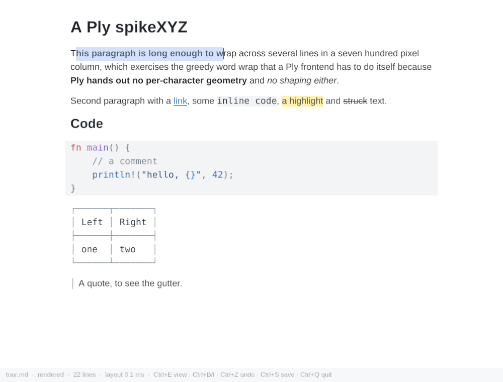

# Spike: leaf on Ply

Can leaf-core's editor run on [Ply](https://github.com/TheRedDeveloper/ply-engine)
(`ply-engine` 1.1.1 from crates.io, 0BSD), a Rust app engine on macroquad that
targets desktop, Android, iOS and the web? Ply has no rich-text widget and,
unlike gpui, hands out no per-character text geometry, so the question is
whether a frontend can bring that part itself.

This directory is its own Cargo workspace, so leaf itself does not depend on
Ply or macroquad.



## Run it

```sh
cargo run --release -- path/to/document.md
```

Keys: arrows (+Shift to select, +Ctrl/Alt by word), Ctrl+Home/End, Backspace,
Delete, Enter, Tab/Shift+Tab, Ctrl+B/I bold/italic, Ctrl+1/2/3 headings,
Ctrl+E rendered/source, Ctrl+Z/Y undo/redo, Ctrl+C/X/V, Ctrl+A, Ctrl+S save,
Ctrl+Q quit. Click to place the caret, Shift+click to extend, drag to select,
double-click a word. The wheel and PageUp/PageDown scroll.

`--script` runs the steps in a file, one per frame, through the same input path
a person's keys take (the step list is on `Step` in `src/main.rs`). The findings
below come from [`tour/tour.txt`](tour/tour.txt) run under Xvfb:

```sh
cp tour/test.md /tmp/test.md
xvfb-run -a -s "-screen 0 1000x760x24" \
  cargo run --release -- /tmp/test.md --script tour/tour.txt   # screenshots in out/
```

## How it is built

About 1,150 lines in three files, shaped like leaf-gpui, plus a 270-line host
(`main.rs`):

- **`layout.rs`**: what leaf-gpui gets from gpui's `shape_line` and does in
  `wrap_logical`/`RowLayout`. It turns `build_visual_unwrapped` rows (or source
  lines) into wrapped lines. Each character carries its x, its advance and its
  source byte; runs of the same style become one text element; and every run
  sits on the line's one baseline. Caret placement, hit-testing and vertical
  motion all read these lines.
- **`editor.rs`**: the widget. Input events go into `Doc` methods, and the
  visible lines come out as Ply elements. The page is one element. Every run,
  the caret, each selection rectangle and each code-block tint is a *floating*
  child at an offset the spike computed, so Ply does no text layout of its own
  here. Only lines inside the viewport are emitted.
- **`fonts.rs`**: five faces (regular, bold, italic, bold italic, mono), read
  from the system at run time, plus the one measurement everything rides on:
  the advance of a character in a face at a size.

## What it found (2026-10-15)

**It works.** Rendered and source views, mixed faces on one baseline, heading
sizes, inline code pills, highlights, links, strikethrough, syntax-highlighted
code blocks, typing, click, drag and double-click selection, Shift+click,
bold/italic toggles, undo/redo, plain clipboard, scrolling with
caret-follows, and up/down over wrapped lines. Every edit is leaf-core's.
The spike never touches the source text itself.

**The measurement holds exactly.** macroquad's `draw_text_ex` places each glyph
at the running sum of the advances before it: no kerning, no shaping. So
measuring one character at a time and summing gives exactly the x Ply draws
at. `check` compares that sum against Ply's own measure of every run: the
worst difference is **0.0000 px** (55 runs). Since Ply measures and draws
through the same function, caret and hit-testing can't drift from the paint.

**What a frontend has to supply itself:**

- **Line breaking.** It's the same greedy word wrap as leaf-gpui. Ply's own
  `WrapMode::Words` can't be used, because the frontend has to know where every
  character went.
- **Baselines.** Ply puts a text element's baseline at its top plus that face's
  ascent (measured from `"Xig"`). Bold, italic and mono differ, so runs placed
  side by side in a row container would sit on different baselines. Floating
  each run at `line baseline − its own ascent` fixes it.
- **Vertical motion.** leaf-core's `move_up`/`move_down` step through *its* rows,
  and `build_visual_unwrapped` makes a whole paragraph one row, so Down jumped
  paragraphs until the spike moved over its own wrapped lines with a sticky x.
  leaf-gpui does the same thing in `vertical_target`. **Home/End are not done**:
  they still reach the paragraph's ends through `move_home`/`move_end`.
- **The caret's position.** A caret offset is not always some glyph's `src`.
  Byte 0 of `# Title` sits before the hidden `# `, and the end of a file with a
  trailing newline is past every row. The spike applies core's
  `pos_of_offset` rule to its own lines: the first stop at or after the
  offset, a tie going to the later line, and the last row as the fallback.
  `pos_of_offset` itself answers in terminal columns, which a pixel frontend
  can't use.

**Ply and macroquad problems:**

- **No font fallback.** A character the face lacks draws as a missing-glyph box.
  Seen here with the `🖼` image placeholder and with `⌃` in the status bar.
  Emoji, CJK and most symbols would need a fallback chain the frontend builds
  itself, choosing a face per character.
- **No shaping.** fontdue has no shaping, so there are no ligatures, no Arabic
  or Indic text and no bidi. Latin text is fine.
- **Typed characters arrive reversed.** `get_char_pressed()` pops a `Vec` from
  the end, so characters that arrive in the same frame come out in reverse.
  `is_key_pressed` also ignores OS key repeat. The spike reads input from
  macroquad's input-subscriber stream (`repeat_all_miniquad_input`) instead,
  which has both in order.
- **No IME.** Ply wires preedit and commit only into its own `text_input`; there
  is no route to `Doc::edit_composing` for a custom widget.
- **Plain clipboard only.** miniquad's clipboard has no HTML flavor, so
  `paste_html` is unreachable.
- **crates.io isn't GitHub `main`.** The published 1.1.1 has `FontAsset` as an
  enum (`Bytes`/`Path`) and `show()` taking a custom-command callback; the
  repository's `main` (and its `SKILL.md`) describe a struct and a no-argument
  `show()`.
- **Fonts as `&'static`.** Ply wants a `&'static FontAsset`, so a font loaded
  at run time is leaked. That's fine for five faces, but it matters for a
  per-character fallback chain. Ply also evicts unused fonts, so the spike
  re-ensures all five every frame.

**Speed.** An idle frame takes 7–9 ms, even with 24,000 lines, because only
visible lines become elements. A keystroke in a 21 KB note costs about 15 ms
for the whole frame: about 1–2 ms in leaf-core's map, 1–2 ms in the spike's
wrap. In a 634 KB document it costs 190–300 ms: 60–85 ms in leaf-core's map
build and 60–120 ms in the spike re-wrapping every line. leaf-gpui avoids the
second by caching each paragraph's breaks against its content and width
(`Shaper::breaks`); the spike has no such cache yet, and it would be the first
thing to add. (The first build of a document also loads the syntax grammars,
about 30 ms once.)

**Not tried:** images and math (the spike asks core for text placeholders, but
`leaf-raster` to `Texture2D` to `ImageSource::Texture` is the obvious route),
tables as a grid (they're drawn as core's box-glyph picture in the mono face,
like the TUI), the web, Android and iOS builds, and HiDPI (`high_dpi: false`
keeps window and mouse pixels equal).

**Verdict.** The core-and-widget split carries over: a Ply frontend is a
layout pass plus input mapping on top of an unchanged leaf-core, and its
geometry is exact because macroquad's text drawing is so simple. The same
simplicity is the ceiling: no fallback, no shaping and no IME. Those are
fine for English notes on desktop. They block Leaf's other users and the
mobile platforms, where Ply's reach would matter most. Before building a real
`leaf-ply` crate, the order would be a font-fallback chain, then IME, then a
per-paragraph wrap cache.
